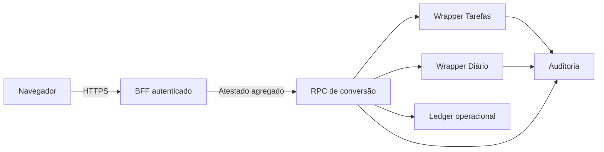

## Executive summary

A composição FR-014 acrescenta uma fronteira privilegiada entre dois domínios clínicos. Riscos principais: misturar origem/caso/ator entre transportes, permitir leitura de recibo sem vínculo vigente e deixar tarefa sem evolução após falha. Este modelo orienta a implementação; **não é prova de controles novos executados**. Flag nova permanece false e validações foram adiadas pelo solicitante.

## Scope and assumptions

Escopo: novos contratos, GET/POST de conversão, preparação nativa de Tarefas/Diário, UI e migration 1200. Evidência existente: `web/ciclo-tarefa-cuidado.ts`, `netlify/functions/_shared/{tarefa-cuidado-nativo,diario-nativo}.ts`, migrations `20261118210000_diario_operacoes_privadas.sql` e `20261125110000_tarefa_autorizacao_somente.sql`. Novos controles são descritos em `design.md`, ainda sujeitos à revisão e execução.

Fora: provedores Google/OpenRouter, login/503 preexistentes, Turno, publicação/CI e gestão de credenciais. CI/hooks são ferramentas de desenvolvimento, não uma autorização clínica.

**SUPOSIÇÕES CONSERVADORAS:** somente Profissional Google com vínculo ativo; uma conversão por origem; evolução gerada apenas para equipe. Solicitante indisponível determinou decidir e registrar, sem perguntas. Prioridades consideram futura ativação pública com informação clínica sensível; nesta passagem somente fixtures fictícias e flag desligada. Não há questão material deixada implicitamente aberta.

## System model

### Primary components

UI de Diário coleta sinalização humana. BFF existente autentica sessão; composição nativa valida e cifra, com material já obtido pelo cofre existente. RPC atômica compõe wrappers privadas de Tarefas e Diário e ledger operacional. As wrappers existentes conferem HMAC, Auth, concessão, vínculo, RLS e auditoria (`*_nativo.ts`, migrations citadas).

### Data flows and trust boundaries

- Navegador para BFF, HTTPS: campos humanos e IDs não confiáveis; cookie/fluxo existentes, contratos strict e perfil. Respostas limitadas a referências; sem texto original no comando de conversão.
- BFF para PostgreSQL, executor existente: transportes cifrados e atestados. Agregado novo deve vincular origem/versão, paciente, ator, sessão, request e filhas antes de qualquer operação.
- RPC para wrappers/ledger, chamada SQL na mesma transação: troca de role SECURITY DEFINER, grants mínimos, RLS, rollback obrigatório e auditoria de negativa independente do subbloco revertido.
- PostgreSQL para navegador: recibo operacional somente após autorização vigente; dados clínicos de Tarefas/Diário continuam nas superfícies existentes, com autorização própria.

#### Diagram

## Assets and security objectives

| Asset | Why it matters | Security objective (C/I/A) |
| --- | --- | --- |
| Conteúdo clínico cifrado | Não expor conteúdo ou ampliar audiência | C/I |
| Origem, tarefa e evolução | Atribuição, proveniência e atomicidade da ação humana | I |
| Recibo/reserva/auditoria | Recuperação sem duplicação nem falsa confirmação | C/I/A |
| Privilégios SQL e cofre existente | Composição não pode abrir caminho privilegiado genérico | C/I |

## Attacker model

### Capabilities

Pessoa anônima ou autenticada com perfil errado, Profissional sem vínculo, vínculo revogado após leitura e cliente adulterado podem enviar IDs/campos, repetir comandos e induzir concorrência/resposta perdida. Executor técnico tem apenas os privilégios já provisionados; novos grants precisam ser confinados.

### Non-capabilities

Não se presume posse do HMAC, chave de cifra, superuser, controle do provedor ou deploy. Compromisso desses ativos exige análise distinta; a assinatura não substitui autorização no banco.

## Entry points and attack surfaces

| Surface | How reached | Trust boundary | Notes | Evidence |
| --- | --- | --- | --- | --- |
| GET/POST conversão | HTTP por IDs de caso/origem | Navegador/BFF | Entrada e recibo novos | `design.md`, decisão 6 |
| RPC agregada | Executor autenticado ou SQL direto | BFF/banco | Deve negar atestado ausente/divergente | `design.md`, decisões 3/4 |
| Wrappers filhas | Chamada interna SQL | Roles/domínios | Não usar a conversão como RPC arbitrária | migrations 18210000/25110000 |
| Reserva e recibo | UI comum ou recarga | Navegador/banco | Ausência de ledger não confirma falha | `web/ciclo-tarefa-cuidado.ts` |
| Auditoria/erro | Falha de operação | Banco/observabilidade | Nunca texto humano, envelope ou causa bruta | `design.md`, decisões 1/2 |

## Top abuse paths

1. Trocar paciente/origem de uma filha e reaproveitar assinaturas válidas; gerar ação com proveniência falsa. Vincular agregado e comparar todos os metadados no SQL.
2. Consultar recibo conhecido após perder vínculo; inferir tarefa e origem de outro caso. Reautorizar antes de consultar ledger, inclusive replay.
3. Provocar falha da evolução depois da tarefa; deixar ação sem sinalização ou repetir criação após recarga. Subtransação reverte ambas e ledger único confirma somente conjunto completo.
4. Atrasar POST e liberar nova tentativa enquanto anterior ainda grava; duplicar/ocultar resultado. Encerramento da barreira cerca geração anterior antes da liberação.
5. Retificar origem entre leitura de versão e conversão; atribuir contexto à versão errada. Serializar no paciente antes da leitura de metadados, preservando ordem dos locks existentes.
6. Explorar nova role/erro para ler cifra ou registrar sucesso falso; limitar grants/colunas, conferir auditoria e não devolver resposta interna das filhas.

## Threat model table

| Threat ID | Threat source | Prerequisites | Threat action | Impact | Impacted assets | Existing controls (evidence) | Gaps | Recommended mitigations | Detection ideas | Likelihood | Impact severity | Priority |
| --- | --- | --- | --- | --- | --- | --- | --- | --- | --- | --- | --- | --- |
| TM-001 | Cliente adulterado | Sessão válida ou acesso direto | Misturar transportes/casos | Ação indevida | Origem/tarefa/evolução | HMAC e validação filhas nos módulos nativos | Vínculo agregado novo | HMAC agregado e igualdade exata de ator/sessão/request/caso/ação | Negativa agregada sem conteúdo | medium: várias entradas relacionadas | high: integridade clínica | high |
| TM-002 | Vínculo revogado | Recibo/origem conhecido | Recuperar após revogação | Exposição entre casos | Ledger | Auth/vínculo nas wrappers | Leitura do ledger nova | Autorizar antes de ledger e replay; negativas SQL diretas | Negativas por request | medium: IDs podem persistir | high: sigilo por caso | high |
| TM-003 | Falha/repetição | Erro na segunda filha | Confirmar gravação parcial | Duplicação e falsa conclusão | Conteúdo/recibo | Transações das filhas existentes | Composição inédita | Subbloco reversível, unicidade e recuperação; testar falha/auditoria/concorrência | Nenhum recibo parcial | medium: falhas são plausíveis | high: ação inconsistente | high |
| TM-004 | Cliente concorrente | POST atrasado/recarregado | Repetir sem cercar geração | Duplicação ou recibo perdido | Reserva | Ciclo de barreira existente | Porta atômica nova | Reutilizar reserva/encerrar/reconhecer e reconsultar ledger | Conflitos sem texto | medium: resposta perdida possível | high: integridade | high |
| TM-005 | Autor concorrente | Retificação simultânea | Converter versão obsoleta | Proveniência incorreta | Origem | Diário trava paciente FOR UPDATE | Lock agregado novo | Mesma ordem de locks e leitura da versão após lock | Conflito de versão | low: exige corrida | high: integridade | high |
| TM-006 | Executor/cliente | Erro ou privilégios excessivos | Ler cifra/forjar sucesso | Vazamento/escalada | Cofre/auditoria | Owners isolados existentes | Role e tratamento novos | Sem acesso direto ao cofre, grants mínimos, respostas fechadas e auditoria obrigatória | Snapshot ACL e falha fechada | low: privilégio limitado | high: dados sensíveis | high |

## Criticality calibration

- Critical: bypass sem sessão que alcança todos os casos; extração de material do cofre. Nenhum desses achados está demonstrado aqui.
- High: conversão fora do caso; tarefa parcial/duplicada com falsa confirmação; vazamento clínico em resposta.
- Medium: bloqueio temporário da conversão de um ator; conflito de concorrência seguro sem perda de registro.
- Low: mensagem genérica pouco clara; indisponibilidade de ação nova com flag desligada e recursos independentes preservados.

## Focus paths for security review

| Path | Why it matters | Related Threat IDs |
| --- | --- | --- |
| `packages/contracts/src/conversao-diario-tarefa.ts` (previsto) | Limites e campos de autoridade | TM-001/002 |
| `netlify/functions/_shared/tarefa-cuidado-nativo.ts` | Extração sem modificar autorização comum | TM-001/006 |
| `netlify/functions/_shared/diario-nativo.ts` | Cifra/AAD e audiência da evolução | TM-001/006 |
| `supabase/migrations/20261125120000_conversao_diario_tarefa_atomica.sql` (prevista) | Agregado, roles, locks e rollback | TM-001/002/003/005/006 |
| `web/ciclo-tarefa-cuidado.ts` e nova composição UI | Cercamento e recuperação após recarga | TM-003/004 |

Cobertura: entradas HTTP/SQL/erro e fronteiras enumeradas; desenvolvimento/CI excluídos da autoridade clínica; indisponibilidade do solicitante e suposições explícitas. Revisão independente e provas novas continuam pendentes, sem certificação implícita.
